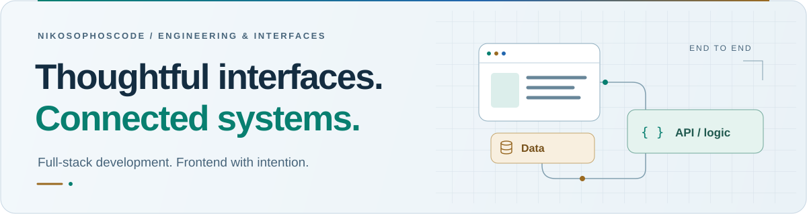
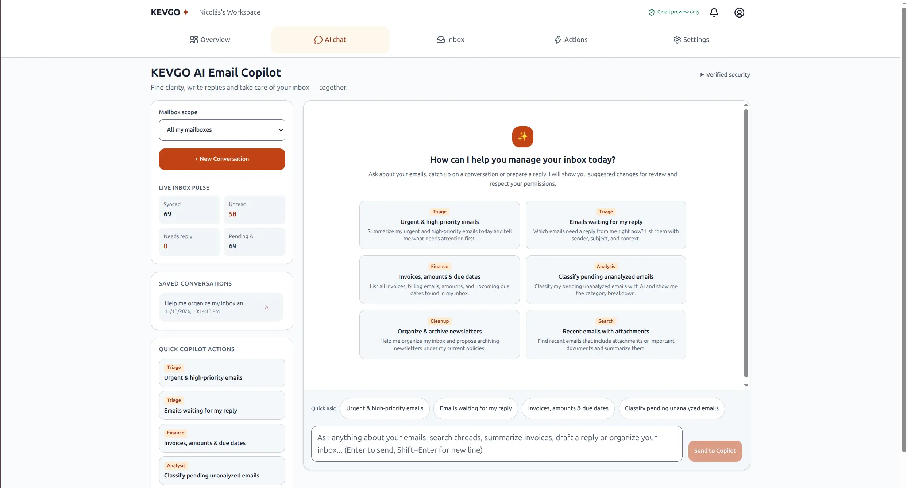
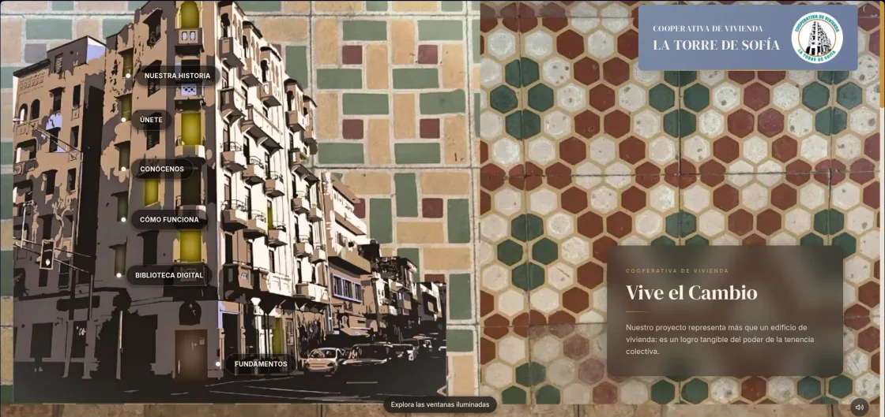
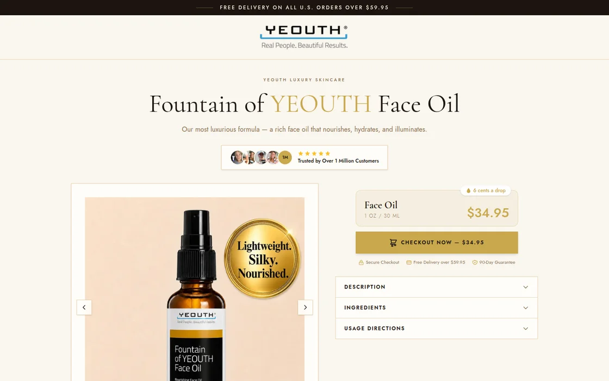

<picture>
  <source media="(prefers-color-scheme: dark)" srcset="./assets/profile/hero-dark.svg">
  <source media="(prefers-color-scheme: light)" srcset="./assets/profile/hero-light.svg">
  
</picture>

# Nicolás Acuña

**Full-stack developer · Frontend-focused · Bogotá, Colombia**

I build across the stack: from APIs, authentication and data workflows to interfaces that feel clear, responsive and considered. My work spans AI-assisted products, immersive websites and e-commerce experiences.

**[Explore my work](#selected-work)** · **[Portfolio](https://nikosophoscode.vercel.app)** · **[LinkedIn](https://www.linkedin.com/in/nikosophoscode/)** · **[Email](mailto:niconiampira@hotmail.com)**

---

## Selected work

### 01 / AIEmailKevgoAutomation

**Full-stack · AI & automation**

An AI-assisted Gmail workspace that brings together inbox synchronization, structured email classification and a conversational copilot.

- **Backend:** a Next.js BFF, a dedicated Node.js worker and shared TypeScript packages for Gmail, model routing, synchronization and policy checks.
- **Data & access:** Supabase/PostgreSQL, owner-scoped row-level security, OAuth with PKCE and token storage through Supabase Vault.
- **Frontend:** an English/Spanish workspace for chat, inbox review, proposed actions and AI usage.

`Next.js` `React` `TypeScript` `Node.js` `Supabase` `PostgreSQL` `Vercel AI SDK`

Development preview from an isolated test harness, not a live Gmail session. Gmail write actions default to simulation; remote acceptance is still pending. Source is not public.

[Discuss this project →](mailto:niconiampira@hotmail.com?subject=AIEmailKevgoAutomation)

### 02 / La Torre de Sofía

**Full-stack · CMS · Interactive storytelling**

A website for a housing cooperative in Río Piedras, Puerto Rico, where the building itself becomes the navigation.

- Interactive SVG windows, cinematic zoom transitions, parallax and subtle audio feedback.
- Payload CMS with PostgreSQL, an editorial admin panel and role-based access.
- Keyboard navigation, reduced-motion support and a dedicated mobile navigation experience.

`Next.js` `React` `TypeScript` `Payload CMS` `PostgreSQL` `Motion` `Zustand`

[Visit the website →](https://www.torredesofia.com/) · Source is not public.

### 03 / YEOUTH Face Oil

**Frontend · U.S. skincare brand · Product landing page**

A dedicated landing page for YEOUTH Face Oil, combining a premium visual direction with a focused product-to-checkout journey.

- Responsive product presentation, image galleries and expandable product information.
- Astro-based delivery, TypeScript and a consistent Tailwind CSS design system.
- E-commerce calls to action and a layout built around the product and its benefits.

`Astro` `TypeScript` `Tailwind CSS` `E-commerce`

[Visit the landing page →](https://faceoil.yeouth.com/) · Source is not public.

### More work, different challenges

#### AllMovies — API-driven frontend

A movie and TV discovery app powered by TMDB: search, browsing, detailed views, favorites and watchlists. A project focused on turning external API data into a cohesive frontend experience.

`React` `TypeScript` `TMDB API` `Axios` `Zustand` `Vite`

[Live app →](https://allmoviesniko.vercel.app/) · [Source code](https://github.com/NikosophosCode/AllMovies)

#### FinDash — Full-stack personal finance

A personal finance dashboard with Notion as its data backend: transaction management, historical budgets, period comparisons and Recharts visualizations. Its Telegram integration supports text and voice workflows, with guarded API routes and idempotent writes.

`Next.js` `TypeScript` `Notion API` `TanStack Query` `Recharts` `NextAuth` `Upstash Redis`

[Discuss this project →](mailto:niconiampira@hotmail.com?subject=FinDash) · Source is not public. No personal financial data is shown here.

#### CuteDogs — API exploration with personality

A playful interface for The Dog API, with random discoveries, breed search, image galleries and locally persisted favorites.

`React` `TypeScript` `The Dog API` `Axios` `Tailwind CSS` `Vite`

[Live app →](https://cutedogs.vercel.app/) · [Source code](https://github.com/NikosophosCode/cute-dogs)

---

## Toolkit

**Technologies I use in the projects above, grouped by purpose.**

- **Frontend:** TypeScript, JavaScript, React, Next.js, Astro, HTML, CSS and Tailwind CSS.
- **Backend & data:** Node.js, Next.js route handlers/BFFs, PostgreSQL, Supabase, Payload CMS and REST APIs.
- **State & interaction:** TanStack Query, Zustand, Motion, React Hook Form and Zod.
- **Integrations:** Gmail API, OAuth/PKCE, Vercel AI SDK, Notion API, Telegram, TMDB and The Dog API.
- **Quality & delivery:** Git, GitHub, Vitest, Testing Library, ESLint, Vite, pnpm/Turborepo and Vercel.
- **Daily environment:** Linux, VS Code and GitHub Copilot.

## How I approach the work

- **Connect the whole journey.** Treat the interface, API contracts, data model and integrations as one product.
- **Make boundaries explicit.** Validate inputs, scope access to the right user and keep sensitive operations on the server.
- **Build for real interaction.** Consider mobile layouts, keyboard navigation, loading states and failure states—not just the happy path.
- **Keep claims grounded.** Distinguish prototypes, simulated actions and live integrations instead of treating them as the same thing.

## Beyond the code

My learning path includes Computer Systems Programming, a programming bootcamp and Platzi. I continue exploring **Python and Java** alongside my web development work.

Outside development: video games, movies and series, reading and writing fiction, travel and live music.

## Let's connect

Interested in a **full-stack or frontend collaboration**? Let's talk about the product, the technical challenge and how I can contribute.

**[LinkedIn](https://www.linkedin.com/in/nikosophoscode/)** · **[Email](mailto:niconiampira@hotmail.com)** · **[Explore my portfolio](https://nikosophoscode.vercel.app)**
